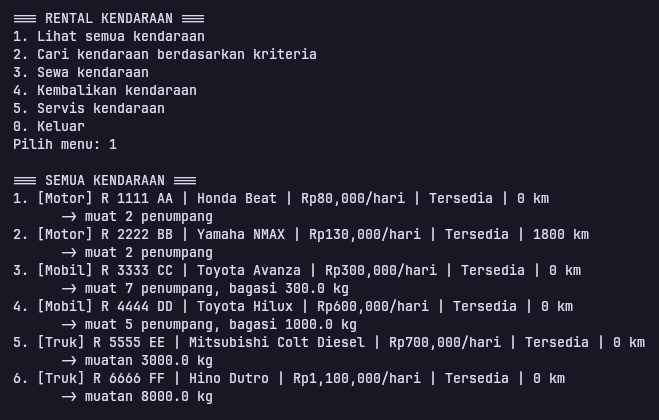
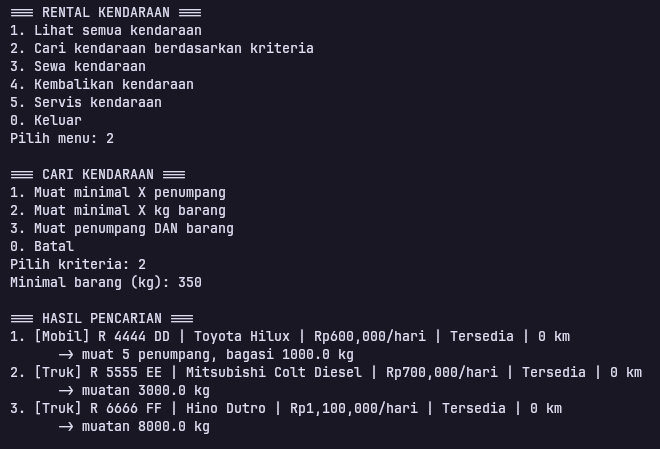
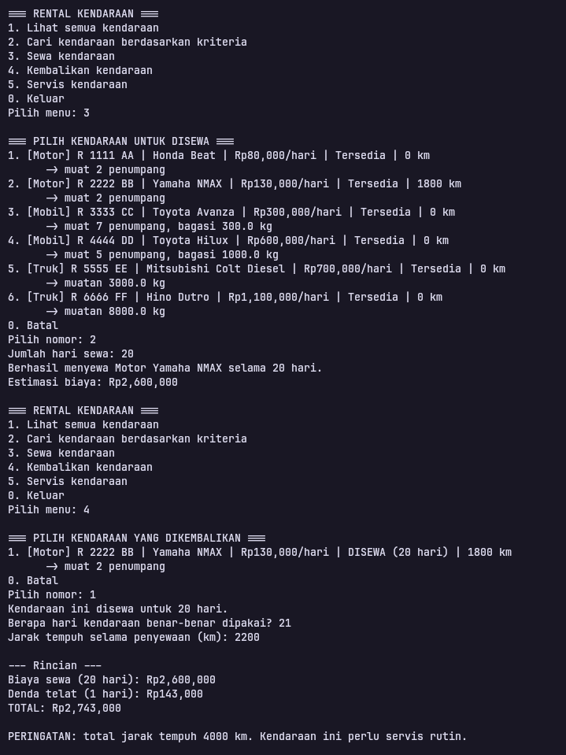
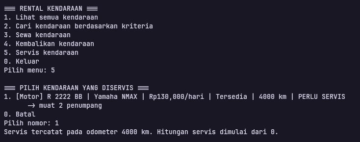

# Sistem Sewa Kendaraan (Responsi Akhir PBO)

## Identitas
- Nama : Reza Kurniawan
- NIM  : H1D025099
- Tema : Otomotif

## Deskripsi
Sistem sewa kendaraan berbasis konsol. Jenis kendaraan: Motor, Mobil, Truk.
Kapabilitas dimodelkan dengan interface `BisaMuatPenumpang` dan `BisaMuatBarang`,
sehingga kendaraan dapat dicari berdasarkan kapasitas penumpang dan/atau barang.

## Compile dan Run (JDK 8 atau lebih baru)
```bash
mkdir out
javac -d out src/*.java
java -cp out Main
```

## Screenshot

### Lihat Semua Kendaraan



### Cari Kendaraan Berdasarkan Kebutuhan



### Alur Sewa dan Pengembalian



### Servis Kendaraan


